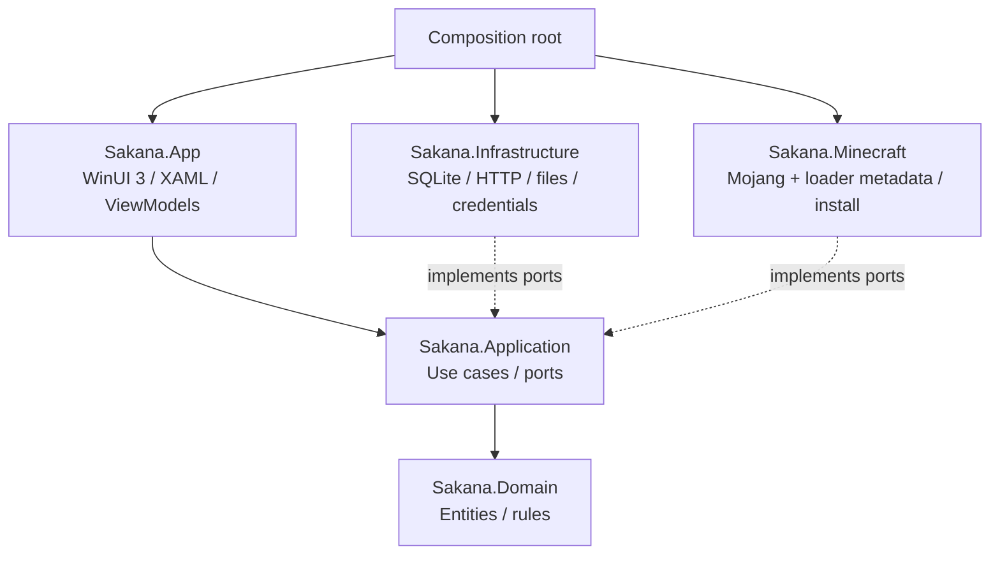

# Architecture

## Guiding decision

Build Sakana as a **modular monolith**: one WinUI 3 desktop process with clear project boundaries. Keep the launcher engine as .NET libraries in the app process initially. Minecraft itself runs as a child process. Add another Sakana process only if updater isolation or a concrete reliability need justifies IPC.

WinUI 3 is Microsoft's native XAML UI framework for new Windows desktop apps. It is delivered through the Windows App SDK and supports C# desktop applications. The product may set its own minimum OS to Windows 11 even though the framework's broader compatibility range is wider. See [WinUI 3](https://learn.microsoft.com/en-us/windows/apps/winui).

## Dependency direction



The UI calls application use cases. It never opens SQLite, writes launcher files, constructs a game command line, or starts a process directly. Infrastructure and Minecraft adapters implement interfaces owned by the application layer. The composition root wires them at startup.

## Solution layout

```text
sakana-launcher/
├── Sakana.slnx
├── src/
│   ├── Sakana.App/             # WinUI window, pages, controls, ViewModels, themes
│   ├── Sakana.Application/     # use cases, ports, validation, UI-facing result models
│   ├── Sakana.Domain/          # instance/account/job entities and invariants
│   ├── Sakana.Minecraft/       # Mojang/Fabric/Quilt/Forge/NeoForge metadata, installation, verification, native extraction
│   └── Sakana.Infrastructure/  # SQLite, filesystem, HTTP, credential vault, logging
├── tests/
│   ├── Sakana.Domain.Tests/
│   ├── Sakana.Application.Tests/
│   └── Sakana.Minecraft.Tests/
└── docs/
```

The current scaffold pins .NET SDK 10.0.404 and Windows App SDK 2.7.0. These are stable versions available when the foundation was created; update them through deliberate servicing rather than floating package references.

Do not split every feature into a separate project yet. Add a Modrinth/provider adapter or a separate updater project when a real feature requires it, rather than creating a plugin system in advance.

## Main application ports

- `IInstanceRepository`: create, list, update, and remove instance metadata.
- `IVersionCatalog`: list available releases and resolve version metadata.
- `IInstallInstance`: plan and run an installation for an instance.
- `IDownloadQueue`: enqueue, observe, cancel, and retry download jobs.
- `IJavaRuntimeService`: detect compatible runtimes and prepare a runtime when required.
- `IAccountSessionService`: sign in, refresh, select, and sign out an account.
- `IMinecraftLaunchPlanner`: validate installed files and build a launch plan from Mojang arguments and an authenticated session.
- `ILaunchGame`: start the child process, stream output/state, and record history.
- `ISettingsRepository`: load and persist user settings.

Long-running calls accept `CancellationToken` and report typed progress. ViewModels translate results into UI state; exceptions are converted at the application boundary into actionable errors with a diagnostic reference.

## Core workflows

### Install an instance

`Create instance → resolve Minecraft and selected loader metadata → download to .part files → verify sizes/hashes → atomically place shared or instance files → extract Windows natives → install the version-matched Java runtime → mark the instance installed`

The installer persists instance state and error, not a durable per-file queue. It writes partial files as `.part`, verifies new downloads against Mojang and loader metadata, uses bounded concurrency, retries transient failures, and reuses official content-addressed assets. Fabric and Quilt profiles are stored with their instance and composed with Mojang metadata. Forge and NeoForge use their official installer jars to generate the loader profile and patched client jar inside the instance, then Sakana verifies and uses the generated libraries and arguments for launch. Java selection checks a configured executable, detects a compatible system Java, then reuses or downloads the version-matched Mojang runtime as needed. A canceled or interrupted install can be retried; automatic per-file resume is a later task. Forge and NeoForge still need end-to-end launch verification on the target Windows machine.

Routine installs reuse an existing Mojang asset when its content-addressed filename and declared size match; Sakana hashes every newly downloaded asset. **Repair** forces full hash checks of existing Mojang game and Java runtime artifacts. Modrinth pack files continue to be checked against their declared hashes.

### Launch a game

`Select instance/account → validate files and runtime → create launch arguments → start javaw/java → stream stdout/stderr → update process state/history`

The application layer can create a launch plan from an authenticated session and start the Java child process. Global launch settings provide defaults and each instance can opt into overrides. The launch plan carries memory, Java arguments, environment variables, window dimensions, and fullscreen state to the process adapter. The adapter passes each argument separately, streams stdout/stderr, redacts the access token from captured output, supports stopping the process tree, and reports the exit code. It prevents two launches for the same instance. Accounts and Library expose device-code sign-in and launch/stop controls; Home displays recent launch history and active process state; the dedicated Logs page filters output by instance and retains the latest 16 MiB of console output per instance. The login application identifier is managed internally and is not shown in the UI. Keep command construction and Java argument rules out of the ViewModel. The launcher owns the Java child-process lifecycle but does not take ownership of the game window.

## Data and files

Use one Sakana-owned root independent of Prism:

```text
%LOCALAPPDATA%\Sakana\
├── Sakana.db
├── instances\<instance-name>\
│   ├── game\
│   │   ├── versions\
│   │   ├── libraries\
│   │   ├── mods\
│   │   ├── resourcepacks\
│   │   ├── shaderpacks\
│   │   ├── screenshots\
│   │   └── logs\
│   ├── loader\
│   └── logs\game-console.jsonl
├── shared\assets\
├── shared\libraries\       # legacy installs and migration fallback
├── runtimes\
├── downloads\
├── cache\
├── logs\
└── backups\
```

For an existing Aurora installation, the app continues using `%LOCALAPPDATA%\Aurora\Aurora.db` and its adjacent data folders. New installs use the Sakana path above; no files are moved during the name change.

SQLite currently stores instance profiles, installation state/error, global launch settings, instance overrides, theme, and launch history (instance/version, start/end time, and exit code). Account metadata and durable per-file job state are future work. Each game's version jars, libraries, mods, configs, resource packs, shaders, screenshots, and worlds live in its own `instances\<instance-name>\game` directory; the instance ID remains the database key. Existing ID-named directories are renamed to the saved instance name during startup, and renaming an instance also renames its folder. Mojang's immutable content-addressed asset cache and managed Java runtimes remain shared to avoid duplicating large resources. Old version jars, native files, and only the libraries needed by that instance are copied from the previous layout on first launch; old files are kept as a recovery copy and remain a fallback if a legacy library is missing. JSON is used for official Minecraft metadata, console log entries, and export/import manifests, not as a second writable source of truth.

Database upgrades use explicit migrations. Startup recovery marks interrupted installs as failed and offers them for retry; a later retry removes any leftover `.part` file before downloading that artifact again. Automatic orphan-file cleanup and per-file resume are still planned.

## Account and secret handling

Game launch requires a live Microsoft account session that passes Xbox/XSTS and Minecraft Java ownership/profile checks; there is no offline or cracked launch mode. Keep account display metadata in memory and access tokens in memory only. The Microsoft refresh credential is protected for the current Windows user with DPAPI and removed on sign-out; the public login application identifier is managed internally and is not stored in SQLite. Redact token values from diagnostics. The account implementation is an adapter so the UI and launch flow do not depend on provider-specific token details.

## Packaging decision

Keep packaging separate from the app architecture. For the first Windows prototype, use the WinUI 3 packaged project path so install/uninstall and identity behavior are exercised early. Before public distribution, choose the actual channel (Store, direct download, or both) and then choose MSIX, packaged-with-external-location, or unpackaged accordingly. Microsoft documents these as separate packaging, distribution, and Windows App SDK runtime decisions; unpackaged apps have additional runtime deployment/bootstrap requirements. See [Package and deploy Windows apps](https://learn.microsoft.com/en-us/windows/apps/package-and-deploy/) and [Windows App SDK deployment overview](https://learn.microsoft.com/en-us/windows/apps/package-and-deploy/deploy-overview).

## Observability and recovery

- Structured rolling logs with a user-visible “Open logs” action.
- Job IDs in errors so support reports can point to the relevant log span.
- Explicit install states: `Queued → Resolving → Downloading → Verifying → Committing → Ready`, with `Failed` and `Canceled` terminal/retry states.
- Startup recovery marks interrupted profile installs so the user can retry them.
- Never include secrets, full auth responses, or unnecessary personal data in logs.
